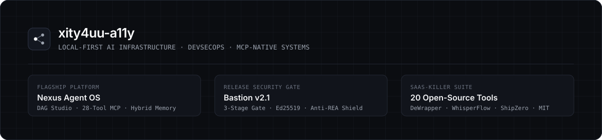

  

   
  
  
  
  

 

Building **local-first, zero-lock-in, MCP-native developer infrastructure** that replaces expensive closed SaaS stacks with fast, cryptographically verifiable, self-hosted open-source platforms.

---

## Featured Flagships

### 1. [nexus-agent-os](https://github.com/xity4uu-a11y/nexus-agent-os) — Local-First Multi-Agent Operating System & Visual Studio (`v1.0.0`)
> Open-source local alternative to **LangSmith**, **CrewAI Enterprise**, **Dify Cloud**, and **Zapier AI**.

- **Visual DAG Studio (Next.js 15)** across 8 node types (`trigger`, `llm`, `agent`, `tool`, `router`, `parallel_map`, `human_approval`, `memory_op`) with live SSE execution streaming.
- **Durable SQLite WAL Checkpointing**, true **Human-in-the-Loop (HITL)** pause/approve/resume, and **Time-Travel Node Replay**.
- **Native 28-Tool MCP Server & Agent `SKILL.md`** (works directly inside Claude Code, Cursor, Codex, OpenClaw, Windsurf, and Antigravity) + **Universal MCP Hub** with SHA-256 tool rug-pull detection.
- **Hybrid FTS5 BM25 + Vector RRF Memory Graph**, **Fernet Encrypted BYOK Secret Vault**, **7,500+ scans/sec Runtime Guardrails**, and **Statistical Eval Arena** (`pass@k`, `pass^k`, 95% bootstrap CIs).

### 2. [bastion](https://github.com/xity4uu-a11y/bastion) — 3-Stage Pre-Ship Security & Anti-AI-Reverse-Engineering Release Gate (`v2.1.0`)
> Automated local DevSecOps web app, CLI, and non-root CI container enforcing security and build hardening before code ships.

- **Gate 1 — Secret Quarantine:** Pluggable external CLI scanners (**TruffleHog** & **MIT Gitleaks**) with strict CI exit code `10`.
- **Gate 2 — Adversarial Source Audit:** Cloudflare 6-phase workflow with genuine two-session BYOK LLM isolation (Hunter vs. Verifier), git-diff scoping, token/cost budget caps, and real Node schema validators (`exit 20`).
- **Gate 3 — Anti-REA Shield (BLA):** Build artifact hardening into `.bla-hardened/`, isolated Post-BLA smoke verification hooks, `--apply`/`--restore`, and **Ed25519 Signed Release Certificates** (JSON, Markdown, PDF) (`exit 30`).

---

## Open-Source Engineering Suite

### AI Agent Engineering & LLM Infrastructure
| Project | Description | Stack | Release |
| --- | --- | --- | --- |
| **[nexus-agent-os](https://github.com/xity4uu-a11y/nexus-agent-os)** | Multi-Agent OS, Visual DAG Studio, 28-Tool MCP Server, Universal MCP Hub, Hybrid Memory Graph & Eval Arena | Python · FastAPI · Next.js 15 · MCP | `v1.0.0` |
| **[prompt-firewall](https://github.com/xity4uu-a11y/prompt-firewall)** | OpenAI/Anthropic/Ollama reverse proxy with prompt-injection scoring, reversible Fernet PII tokenization vault, YAML tool policies & cost circuit breakers | Python · FastAPI · Next.js 15 | `v1.0.0` |
| **[mcp-forge](https://github.com/xity4uu-a11y/mcp-forge)** | Universal MCP JSON-RPC 2.0 inspector, stdio proxy, SHA-256 lockfile rug-pull auditor, schema boundary fuzzer & SARIF reporter | TypeScript · Node.js 22 (0 runtime deps) | `v1.0.0` |
| **[agent-replay](https://github.com/xity4uu-a11y/agent-replay)** | Deterministic time-travel debugger, SHA-256 `.replay` bundle SDK, side-by-side trajectory differ & `pass@k`/`pass^k` CI harness | Python · FastAPI · Typer | `v1.0.0` |
| **[rag-xray](https://github.com/xity4uu-a11y/rag-xray)** | Offline RAG forensic debugger comparing chunkers x BM25/Dense SVD/Hybrid RRF with Recall@K, MRR, NDCG@K & blind-spot diagnosis | Python · NumPy · FastAPI · Next.js 15 | `v1.0.0` |
| **[local-eval-arena](https://github.com/xity4uu-a11y/local-eval-arena)** | Local LLM benchmark & prompt regression suite with 7 deterministic graders, 95% bootstrap CIs, paired permutation tests & Bradley-Terry Elo | Python · FastAPI · Typer | `v1.0.0` |

### Security, Forensics & Supply-Chain Defense
| Project | Description | Stack | Release |
| --- | --- | --- | --- |
| **[bastion](https://github.com/xity4uu-a11y/bastion)** | 3-Stage Pre-Ship Security & Anti-REA Release Gate with Fernet vault, Ed25519 certificates & AGPL-clean `Dockerfile.cli` | Python · FastAPI · Next.js 15 | `v2.1.0` |
| **[dep-detective](https://github.com/xity4uu-a11y/dep-detective)** | Multi-ecosystem lockfile supply-chain hunter (`npm`, `Python`, `Cargo`, `Go`) with typosquatting, blast-radius graph, CycloneDX 1.5 SBOM & SARIF | Python · FastAPI · Typer | `v1.0.0` |
| **[api-drift](https://github.com/xity4uu-a11y/api-drift)** | 3-way OpenAPI 3.0/3.1 vs. AST routes (FastAPI, Express, Next.js) vs. HAR 1.2 traffic shadow-endpoint & auth-guard auditor | Python · AST · FastAPI · SARIF | `v1.0.0` |
| **[cert-watch](https://github.com/xity4uu-a11y/cert-watch)** | X.509 PEM/DER chain auditor, live TLS handshake probe, OpenSSH & JWT posture inspector with Ed25519 signed snapshots | Python · cryptography · FastAPI | `v1.0.0` |
| **[log-sleuth](https://github.com/xity4uu-a11y/log-sleuth)** | Streaming 5-format log forensics engine (JSONL, Nginx, Syslog, GitHub Audit, CloudTrail) with anomaly correlation & incident timelines | Python · FastAPI · Typer | `v1.0.0` |
| **[sandbox-runner](https://github.com/xity4uu-a11y/sandbox-runner)** | Zero-trust local script execution harness with Merkle filesystem diffing, strict ambient env scrubbing, copy-on-run isolation & Ed25519 attestations | Python · cryptography · SQLite · FastAPI | `v1.0.0` |

### Systems, Databases & Developer Tools
| Project | Description | Stack | Release |
| --- | --- | --- | --- |
| **[sql-pulse](https://github.com/xity4uu-a11y/sql-pulse)** | PostgreSQL & SQLite migration safety linter with zero-downtime rewrites, dual `EXPLAIN` flame-plan analyzer & ORM N+1 query hunter | Python · FastAPI · Next.js 15 | `v1.0.0` |
| **[code-topo](https://github.com/xity4uu-a11y/code-topo)** | Multi-language AST architecture cartographer (Python, TS/JS, Go, Rust), Tarjan SCC cycle detector, YAML boundary enforcer & Git churn radar | Python · AST · FastAPI · SVG | `v1.0.0` |
| **[webhook-lab](https://github.com/xity4uu-a11y/webhook-lab)** | Local webhook capture & SSE studio, constant-time HMAC-SHA256 signer/verifier (Stripe, GitHub, Slack) & 5-invariant chaos/idempotency testbench | TypeScript · Node.js 22 (0 runtime deps) | `v1.0.0` |
| **[diff-lens](https://github.com/xity4uu-a11y/diff-lens)** | Semantic Git PR & release risk analyzer combining AST symbol breaking-change detection, blast radius callers, checklists & Conventional Commit changelogs | Python · AST · FastAPI · Typer | `v1.0.0` |
| **[wire-mock-studio](https://github.com/xity4uu-a11y/wire-mock-studio)** | Record-and-replay HTTP & pure RFC 6455 WebSocket contract simulator, automatic PII cassette sanitizer, chaos proxy & live drift verifier | TypeScript · Node.js 22 (0 runtime deps) | `v1.0.0` |

---

### Core Engineering Principles
- **Local-First & Zero Telemetry:** Every tool runs offline on your machine with SQLite and BYOK LLM keys encrypted via Fernet outside your repo.
- **MCP-Native Interoperability:** First-class JSON-RPC 2.0 MCP servers and `SKILL.md` specifications designed to supercharge Claude Code, Cursor, Codex, OpenClaw, and Antigravity.
- **Cryptographic Verifiability:** Ed25519 release/execution attestations, SHA-256 content-addressed lockfiles, CycloneDX 1.5 SBOMs, and SARIF v2.1.0 security outputs.
